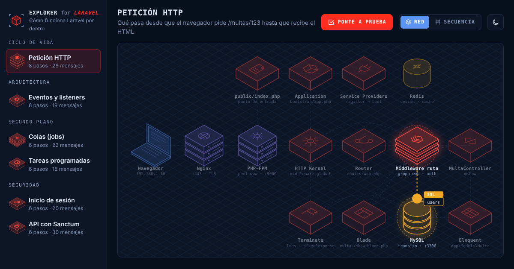

# Explorer for Laravel

**▶ Demo en vivo: <https://luizjack.github.io/explorer-for-laravel/>**

Explorador visual e interactivo de los procesos internos de **Laravel**. Cada proceso se divide en pasos, se dibujan los componentes que participan y se anima cada mensaje que viaja entre ellos. Al final puedes ponerte a prueba.



Si te sirve, déjale una estrella ⭐ al repositorio y compártelo con alguien que esté aprendiendo Laravel.

Inspirado en [Protocol Explorer](https://protocol-explorer-alpha.vercel.app/) de Dilum Sanjaya, que hace lo mismo con los protocolos de red.

> Proyecto independiente de la comunidad. No está afiliado a Laravel ni respaldado por sus creadores. Laravel es una marca registrada de Laravel Holdings Inc.

## Qué tiene

- **Vista Red:** cada componente (Nginx, PHP-FPM, Redis, MySQL, controladores, middleware…) es un ícono isométrico dibujado en SVG sobre una cuadrícula tipo plano técnico. Los mensajes viajan como paquetes animados con su tarjeta de tipo y contenido.
- **Vista Secuencia:** el mismo proceso como diagrama de secuencia, con líneas de vida y flechas que se van marcando.
- **Panel del paso actual:** explicación, datos clave y el código Laravel relevante.
- **Flujo de mensajes:** tabla con tiempos, origen, destino y detalle de cada mensaje.
- **Ponte a prueba:** dos tests por proceso, con puntaje para compartir.
  - *Predice el siguiente paso:* la animación se detiene y eliges a qué componente va el próximo mensaje.
  - *Preguntas:* opción múltiple, con la explicación al responder.
- Menú lateral con buscador, tema claro/oscuro y diseño adaptable a celular.

## Procesos incluidos

| Proceso | Qué muestra |
|---|---|
| **Petición HTTP** | Nginx → PHP-FPM → `index.php` → Service Providers → HTTP Kernel → Router → middleware de ruta → controlador → Eloquent/MySQL → Blade → respuesta → `terminate()` |
| **Eventos y listeners** | `Evento::dispatch()` → listener síncrono → listener en cola (`ShouldQueue`) → difusión en tiempo real con Reverb y Echo (`ShouldBroadcast`) |
| **Colas (jobs)** | `dispatch()` → Redis → worker (`queue:work` + Supervisor) → `handle()` → fallo por timeout → reintento con *backoff* → confirmación / `failed_jobs` |
| **Tareas programadas** | cron → `schedule:run` → tareas que vencen → lock de `withoutOverlapping()` → comando en proceso aparte → `pingOnSuccess()` → `Schedule::job()` a la cola |
| **Inicio de sesión** | Formulario → CSRF → `LoginRequest` + RateLimiter → `Auth::attempt()` → User Provider → `Hash::check()` → sesión regenerada → redirección |
| **API con Sanctum** | Login de una app móvil → `createToken()` (se guarda el hash) → petición con `Bearer` → validación del token y sus habilidades → API Resource en JSON → revocación |

Los ejemplos siguen las convenciones de Laravel 11 y 12.

## Cómo ejecutarlo

No tiene dependencias ni proceso de build. Cualquiera de estas opciones sirve:

- Abrir `index.html` directamente en el navegador.
- En VS Code, con la extensión **Live Server**: clic derecho sobre `index.html` → *Open with Live Server*.
- Desde la terminal:

  ```bash
  python -m http.server 8000
  # o
  npx serve .
  ```

  y abrir <http://localhost:8000>.

**Atajos:** `Espacio` reproducir/pausar · `←` `→` mensaje anterior/siguiente · `Inicio` reiniciar · `S` cambiar entre Red y Secuencia. En los tests, `1`–`4` eligen una opción y `Esc` sale.

**Enlaces directos:** `index.html#queue` abre un proceso; `index.html#queue/test` abre su test.

## Estructura

```
explorer-for-laravel/
├── index.html
├── og-image.png            # vista previa al compartir el enlace
├── CONTRIBUTING.md         # guía para contribuir
├── scripts/
│   └── validate.js         # revisa que los procesos estén bien formados
├── css/
│   └── styles.css          # estilos "plano técnico", tema claro/oscuro
└── js/
    ├── app.js              # motor: vistas Red y Secuencia, animación, controles, tabla
    ├── icons.js            # íconos isométricos dibujados por código
    ├── quiz.js             # modo "Ponte a prueba"
    ├── analytics.js        # estadísticas de uso opcionales (GoatCounter)
    └── scenarios/
        ├── http.js         # ciclo de vida de una petición
        ├── events.js       # eventos, listeners y difusión
        ├── queue.js        # colas y reintentos
        ├── scheduler.js    # tareas programadas
        ├── login.js        # inicio de sesión
        └── sanctum.js      # API con tokens
```

## Agregar un proceso nuevo

1. Crea `js/scenarios/mi-proceso.js`:

   ```js
   window.SCENARIOS = window.SCENARIOS || [];
   window.SCENARIOS.push({
     id: 'migraciones',               // se usa en la URL: #migraciones
     name: 'Migraciones',             // texto en el menú lateral
     category: 'Base de datos',       // grupo del menú lateral
     icon: { kind: 'db', group: 'laravel' },   // ícono en el menú
     tagline: 'Qué hace php artisan migrate',
     nodes: [
       // x: 80–920, y: 110 / 300 / 490
       // group: client | server | laravel | data | external
       { id: 'artisan', label: 'migrate', sub: 'php artisan', x: 80, y: 300, group: 'laravel',
         icon: { kind: 'block', glyph: 'terminal' } },   // opcional; si falta, se elige por id o por grupo
       { id: 'db', label: 'MySQL', sub: 'tabla migrations', x: 300, y: 300, group: 'data' }
     ],
     steps: [
       {
         title: 'Qué falta por correr',
         subtitle: 'Se consulta la tabla migrations',
         description: 'Explicación del paso…',
         code: `php artisan migrate`,
         facts: [['Tabla de control', 'migrations']],
         events: [
           // type: request | response | sql | cache | queue | internal | error
           { t: 0.000, from: 'artisan', to: 'db', type: 'sql', label: 'migrations',
             info: 'select `migration` from `migrations` order by `batch` asc',
             // Opcional: convierte este mensaje en un reto de "Predice el siguiente paso"
             ask: 'migrate necesita saber qué migraciones ya corrieron. ¿Dónde lo consulta?' }
         ]
       }
     ],
     // Opcional: preguntas del test. `answer` es la posición de la opción correcta
     // (las opciones se barajan al mostrarse). `nodes` se resaltan al responder.
     quiz: [
       {
         q: '¿Dónde anota Laravel qué migraciones ya se ejecutaron?',
         options: ['En la tabla migrations', 'En el archivo .env', 'En storage/logs', 'En la caché'],
         answer: 0,
         explain: 'Cada migración ejecutada queda registrada con su número de lote (batch).',
         nodes: ['db']
       }
     ]
   });
   ```

2. Agrégalo en `index.html` antes de `js/app.js`:

   ```html
   <script src="js/scenarios/mi-proceso.js"></script>
   ```

Las aristas del diagrama se crean solas a partir de los mensajes, y si una línea atraviesa otro nodo se dibuja curva. Si un proceso no tiene mensajes con `ask`, el test «Predice el siguiente paso» elige hasta ocho mensajes por su cuenta.

**Íconos disponibles** (`js/icons.js`):

- `kind`: `laptop`, `phone`, `server`, `block`, `stack`, `cylinder`, `db`, `cloud`
- `glyph` (símbolo sobre la cara superior): `file`, `box`, `plug`, `gear`, `route`, `layers`, `code`, `table`, `layout`, `flag`, `send`, `briefcase`, `eye`, `key`, `user`, `hash`, `shield`, `bell`, `form`, `bolt`, `x`, `globe`, `mail`, `clock`, `calendar`, `terminal`, `lock`, `chart`, `braces`, `broadcast`

Antes de enviar un cambio, comprueba los procesos con `node scripts/validate.js`.

## Contribuir

Las contribuciones son bienvenidas: proponer un proceso, corregir una explicación o mejorar una pregunta.

- **¿Tienes una idea?** Abre un issue con la plantilla [Proponer un proceso](https://github.com/LuizJack/explorer-for-laravel/issues/new/choose). No hace falta programarlo.
- **¿Quieres escribirlo?** Lee la [guía para contribuir](CONTRIBUTING.md) y envía un pull request desde tu fork.

Procesos que faltan: el contenedor de servicios, validación con Form Requests, migraciones, políticas y gates, caché, notificaciones, Livewire.

## Seguridad

Para reportar una vulnerabilidad, consulta [SECURITY.md](SECURITY.md).

## Licencia

[MIT](LICENSE)
